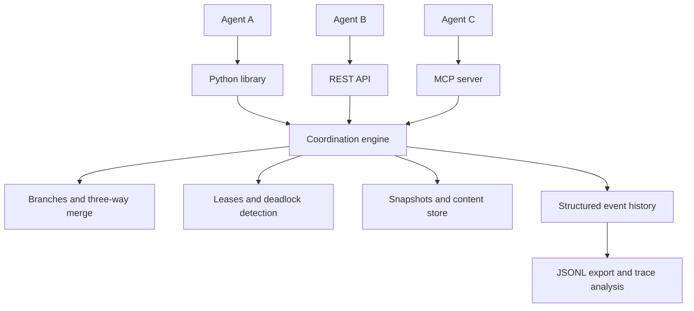

<div align="center">


**Coordinate your AI agents. Make every agent count.**

Shared state, clear ownership, and conflict-aware collaboration for multi-agent systems.

[](LICENSE)
[](python/)

[Quick start](#quick-start) · [Core capabilities](#what-you-can-build-with-cohort) · [MCP integration](#connect-through-mcp) · [Deployment](#deployment)

</div>

---

## Give every agent a way to work together

As soon as multiple agents work on the same project, coordination becomes a real engineering problem.

One agent updates a record while another changes it. Two agents repeat the same task. A worker continues from an outdated version of shared state. The result is wasted time, wasted tokens, and work that has to be repaired.

**Cohort gives agents a shared coordination layer.**

Agents can work in isolated branches, make changes independently, and bring those changes back through conflict-aware commits. Leases help coordinate access to shared resources, while a structured event log records what happened.

Use Cohort alongside the agent framework and tools you already work with.


## What you can build with Cohort

| Capability | What it does |
| --- | --- |
| **Shared workspace** | Give agents a common key-value state they can read and update. |
| **Isolated branches** | Let agents work independently from a shared snapshot before committing changes. |
| **Conflict detection** | Detect concurrent changes to the same key instead of silently overwriting one agent's work. |
| **Controlled conflict resolution** | Apply an explicit resolver strategy and record the decision in the event history. |
| **Resource leases** | Coordinate temporary ownership of shared keys and resources. |
| **Deadlock detection** | Detect cycles in the wait-for graph so agents do not wait indefinitely. |
| **Event history and replay** | Inspect coordination events and reconstruct workspace state from stored history. |
| **Content-addressed snapshots** | Hash canonicalized values and verify reconstructed snapshot identities. |
| **REST API** | Connect applications to workspace state, branches, commits, leases, and events. |
| **MCP tools** | Experiment with workspace coordination through an MCP server and compatible local clients. |

Cohort focuses on coordination: shared state, concurrent changes, ownership, and traceable decisions. Your agents and framework remain responsible for planning tasks, calling models, and executing external tools.

## Quick start

### 1. Install

Requires Python 3.10 or newer.

From the repository root:

```bash
python -m pip install -e "./python"
```

For development:

```bash
python -m pip install -e "./python[dev]"
python -m pytest python/tests
```

### 2. Let agents work independently

Each branch starts from a workspace snapshot. Agents can make changes without immediately modifying the shared head.

```python
from cerbere_cohort import ConflictError, Workspace

workspace = Workspace()
workspace.seed({"spec/auth": "initial"})

agent_a = workspace.create_branch("agent-a", "draft-a")
agent_b = workspace.create_branch("agent-b", "draft-b")

agent_a.set("spec/auth", "written by agent A")
agent_b.set("spec/auth", "written by agent B")

workspace.commit("agent-a", agent_a)

try:
    workspace.commit("agent-b", agent_b)
except ConflictError as exc:
    print("Conflict:", exc.conflicting_keys)

print(workspace.head.data)
# {"spec/auth": "written by agent A"}
```

The second commit is rejected because both agents changed the same key differently. The accepted state is preserved; the conflicting change must be handled explicitly.

### 3. Merge independent work

Changes to different keys can be committed without creating a conflict.

```python
from cerbere_cohort import Workspace

workspace = Workspace()
workspace.seed({"status": "new", "owner": "unassigned"})

agent_a = workspace.create_branch("agent-a", "update-status")
agent_b = workspace.create_branch("agent-b", "assign-owner")

agent_a.set("status", "in-progress")
agent_b.set("owner", "agent-b")

workspace.commit("agent-a", agent_a)
workspace.commit("agent-b", agent_b)

print(workspace.head.data)
# {"status": "in-progress", "owner": "agent-b"}
```

### 4. Choose how conflicts are resolved

Cohort provides resolver strategies including `PreferBranch`, `PreferHead`, and `PreferAgent`.

```python
from cerbere_cohort import PreferBranch, Workspace

workspace = Workspace()
workspace.seed({"config": "v1"})

agent_a = workspace.create_branch("agent-a", "a")
agent_b = workspace.create_branch("agent-b", "b")

agent_a.set("config", "v2")
agent_b.set("config", "v3")

workspace.commit("agent-a", agent_a)
workspace.commit("agent-b", agent_b, resolver=PreferBranch())

print(workspace.head.data)
```

A resolver makes the conflict policy explicit. It does not determine whether the selected value is semantically correct, so choose a strategy that fits your application.

## Coordinate access with leases

When several agents need the same resource, leases provide temporary ownership. Enable lease enforcement with `require_leases=True` to require ownership before a branch writes to a key.

```python
from cerbere_cohort import LeaseError, Workspace

workspace = Workspace(require_leases=True)
branch = workspace.create_branch("agent-a", "change-schema")

try:
    branch.set("db/schema", {"version": 2})
except LeaseError:
    workspace.acquire_lease("agent-a", "db/schema", duration_seconds=60)
    branch.set("db/schema", {"version": 2})
```

Leases also support waiting with a timeout. Cohort maintains a wait-for graph and raises `DeadlockError` when it detects a cycle.

## Keep a durable coordination history

The local persistent workspace stores content objects, events, and active leases in SQLite. On reopening, it reconstructs state from the event log and validates snapshot IDs.

```python
from cerbere_cohort.persistence import PersistentWorkspace

with PersistentWorkspace("workspace.db") as workspace:
    branch = workspace.create_branch("agent-a", "task-1")
    branch.set("task/status", "complete")
    workspace.commit("agent-a", branch)

    print(workspace.head.data)
    print(workspace.get_event_count())
    workspace.export_events_jsonl("events.jsonl")
```

Events can be inspected through the Python API and exported as JSONL for further analysis. The repository also includes a Rust trace CLI for basic analysis of versioned event logs.

## Connect through MCP

The MCP integration lives in `integrations/mcp-server`. It exposes tools for workspace state, branches, branch values, commits, leases, and events.

Install and run from the repository root:

```bash
python -m pip install -e "./python"
cd integrations/mcp-server
python -m pip install -e .
```

Run with stdio for a local MCP client:

```bash
cerbere-cohort-mcp --transport stdio
```

For local development, the server also supports Streamable HTTP on `127.0.0.1:8765` by default:

```bash
cerbere-cohort-mcp
```

The MCP integration is an early implementation. Its branch registry is currently separate from the REST API branch registry. When `DATABASE_URL` is configured, the server requires stdio; authenticated remote MCP transport is not yet available. Do not expose the local HTTP transport publicly.

## Use the interface that fits your setup

| Interface | Use it for |
| --- | --- |
| **Python library** | Add coordination directly to Python agent workflows and applications. |
| **REST API** | Connect a frontend or service to workspace state and coordination operations. |
| **MCP server** | Expose Cohort coordination tools to a local MCP-compatible client. |
| **SQLite persistence** | Keep local workspace state and event history between runs. |
| **PostgreSQL adapter** | Run the hosted API with PostgreSQL-backed persistence. |

The REST service is built with FastAPI. In hosted PostgreSQL mode, it validates Supabase JWTs and checks active membership for the requested organization. Each organization is routed to its own PostgreSQL schema.

## Deployment

- [Deploy the SaaS beta](docs/DEPLOYMENT.md) — Vercel, Render, Supabase, environment variables, and verification.
- [Closed beta tester guide](docs/TESTER_GUIDE.md) — safe test scope, the multi-agent golden path, known limits, and feedback reporting.
- [Self-host Cohort Community](docs/SELF_HOSTING.md) — Docker Compose with local SQLite.
- [Traction measurement](docs/TRACTION.md) — GitHub clone archive, opt-in installation telemetry, and product adoption metrics.

## How Cohort works

At a high level, agents interact with a coordination engine through the Python library, REST API, or MCP integration.



### Repository structure

```text
.
├── python/
│   ├── src/cerbere_cohort/       # Python coordination library
│   └── tests/                    # Python test suite
├── crates/
│   └── cerbere-cohort-trace/     # Rust JSONL trace CLI
├── integrations/
│   └── mcp-server/               # MCP server
├── schemas/                      # Event schema
├── examples/                     # Runnable examples
└── docs/                         # Guides and design notes
```

## Current version

Cohort is under active development. The current implementation includes the key-value workspace, isolated branches, three-way merge, conflict detection and resolver strategies, leases, wait-for deadlock detection, content-addressed snapshots, event replay, SQLite persistence, a PostgreSQL adapter for the hosted API, and a FastAPI REST service.

A few implementation details matter when evaluating the current release:

- Multiple organizations are isolated into separate PostgreSQL schemas, but the hosted API must run as one instance and one Uvicorn worker because runtime and branch registries are process-local.
- The MCP server uses a separate branch registry from the REST API.
- The MCP server requires stdio when `DATABASE_URL` is configured; authenticated remote MCP transport is not implemented.
- The workspace is key-value based. Conflict detection operates at key granularity.
- The Rust trace analyzer is an early tool for basic JSONL analysis.
- Agent credentials are bound to an agent identity, and audit events distinguish the authenticated actor from the target agent. Cohort does not provide external tool authorization or code sandboxing.
- Conflict resolution policies do not guarantee semantic correctness of application data.

The hosted API's route definitions and request/response models in the source code are the reference for exact API behavior. Run the service to access FastAPI's interactive documentation at `/docs`.

## What's next

We are working toward stronger coordination across agent runtimes and deployment environments, including:

- Fencing-token enforcement at the storage boundary to reject writes from stale lease holders.
- A unified branch and coordination model across REST and MCP.
- More granular agent scopes and delegated permission controls.
- Document-oriented workspaces and richer shared resources.
- Multi-instance coordination behind a shared runtime and branch registry.
- Broader framework integrations and more useful trace analytics.

These are development directions, not claims about features already shipped. See [docs/CONCEPTS.md](docs/CONCEPTS.md) for design notes and open questions.

## Security and data handling

The hosted REST API authenticates human users with Supabase JWTs and checks active membership for the requested organization. Agent credentials are bound to their own agent identity; audit events record the initiating principal separately from the affected agent. This does not provide external tool authorization or code sandboxing.

Local library and SQLite development usage do not provide an authenticated public API. Do not expose them directly to the internet. Workspace values and event payloads may contain application data; apply appropriate redaction, access controls, and retention policies before storing sensitive information.

Read [SECURITY.md](SECURITY.md) before reporting a vulnerability.

## Contributing

Contributions and concrete failure reports are welcome. Read [CONTRIBUTING.md](CONTRIBUTING.md) before opening a pull request. Useful reports include the number of agents, the shared state involved, the operations performed, and the expected versus observed behavior.

## License

MIT. See [LICENSE](LICENSE).

> ⭐ If Cohort saved you from a silent overwrite, star the repo — it helps us keep building in public.
